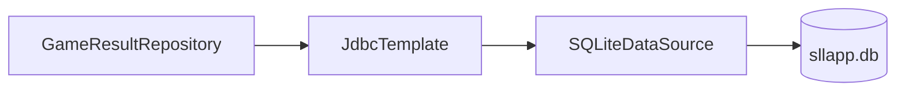

# Backend architecture

The SLLAPP backend uses Java 21 and Spring Boot. It stores game results in a local
SQLite database and provides repository methods for saving results and reading
them in ranking order.

See the [README](../README.md) for local setup and commands.

## WebSocket transport

`game.session.websocket` registers the plain JSON endpoint `/ws`, validates
message envelopes and reports protocol errors. `SessionWebSocketProperties`
configures application and container message limits. `config.WebConfiguration`
and `WebProperties` configure REST CORS and provide the same origin list to
the WebSocket handshake. `SessionWebSocketTest` checks the running server with
JDK HTTP and WebSocket clients.

`game.session.GameSession` is an immutable player session with UUID, nickname,
selected hand and creation/expiry timestamps. `SessionRegistry` holds sessions
in memory and uses the injected UTC `Clock` to check expiry. `NicknamePolicy`
validates player names. These classes do not depend on WebSocket objects.
The handler implements `create_session` and `resume_session`; its connection
registry keeps Spring sockets separate from player data. Ownership changes are
serialized per game session. Closing an old socket cannot detach its replacement.
Outbound messages use `ConcurrentWebSocketSessionDecorator` to serialize sends.

## Ranking HTTP API

`RankingController` serves `GET /api/ranking` and validates the optional limit
(default 10, range 1–100). Its exception handler maps invalid limits to a
`400 ProblemDetail` response. `RankingService` reads the ordered results from
`GameResultRepository` in `game.result` and assigns positions starting at 1. `RankingEntryResponse`
contains `rank`, `nickname` and `score`. See the [API reference](api.md).

## Code structure

The application package is `pl.pjatk.ai.sllapp`:

```text
backend/src/
├── main/
│   ├── java/pl/pjatk/ai/sllapp/
│   │   ├── SllappApplication.java
│   │   ├── config/
│   │   │   └── SqliteConfiguration.java
│   │   ├── game/
│   │   │   └── result/
│   │   │       ├── GameResult.java
│   │   │       └── GameResultRepository.java
│   │   └── ranking/
│   │       ├── RankingController.java
│   │       ├── RankingService.java
│   │       └── RankingEntryResponse.java
│   └── resources/
│       ├── application.yml
│       └── schema.sql
└── test/java/pl/pjatk/ai/sllapp/
    ├── game/result/
    │   └── GameResultRepositoryTest.java
    └── ranking/
        └── RankingApiTest.java
```

| File | Responsibility |
| --- | --- |
| [`SllappApplication.java`](../backend/src/main/java/pl/pjatk/ai/sllapp/SllappApplication.java) | Spring Boot entry point |
| [`GameResult.java`](../backend/src/main/java/pl/pjatk/ai/sllapp/game/result/GameResult.java) | Immutable result record |
| [`GameResultRepository.java`](../backend/src/main/java/pl/pjatk/ai/sllapp/game/result/GameResultRepository.java) | SQL operations through `JdbcTemplate` and row mapping |
| [`SqliteConfiguration.java`](../backend/src/main/java/pl/pjatk/ai/sllapp/config/SqliteConfiguration.java) | Storage directory creation and SQLite `DataSource` |
| [`application.yml`](../backend/src/main/resources/application.yml) | Server, storage and schema initialization settings |
| [`schema.sql`](../backend/src/main/resources/schema.sql) | Result table and ranking index |

## Startup and configuration

`SllappApplication` starts Spring Boot. `SqliteConfiguration` resolves the storage
directory to an absolute path, creates the directory and configures a
`SQLiteDataSource` for `sllapp.db`. Spring runs `schema.sql` on startup through
`spring.sql.init.mode=always`. The schema uses `CREATE TABLE IF NOT EXISTS` and
`CREATE INDEX IF NOT EXISTS`.

| Setting | Value in `application.yml` |
| --- | --- |
| `server.address` | `127.0.0.1` |
| `server.port` | `8080` |
| `sllapp.storage.directory` | `${DATA_DIR:./data}` |
| `spring.sql.init.mode` | `always` |

The default database path is `./data/sllapp.db`, relative to the backend process
working directory. Set `DATA_DIR` to use another directory. Keeping the database
file preserves saved results across application restarts.

## Stored result

`GameResult` is a Java record with `sessionId`, `nickname`, `score` and `finishedAt`.
The repository maps it to `game_results`:

| Column | SQLite type | Constraint |
| --- | --- | --- |
| `session_id` | `TEXT` | Primary key, required |
| `nickname` | `TEXT` | Required |
| `score` | `INTEGER` | Required, non-negative |
| `finished_at` | `TEXT` | Required |

The repository formats the `Instant` finish timestamp in UTC with nine fractional
digits and parses it back to `Instant` on read.

## Repository operations

The repository receives `JdbcTemplate` through its constructor.



`save(GameResult)` inserts a row and returns `true` when the insert succeeds.
`ON CONFLICT (session_id) DO NOTHING` keeps the original row on a repeated session
identifier; the method returns `false` for that duplicate.

`findTopResults(int limit)` returns a list of results in this order:

1. Score descending.
2. Finish time ascending.
3. Session identifier ascending.

The session identifier gives a stable order when score and finish time match.
The `game_results_ranking_idx` index uses the same ordering. The query takes its
row limit as a bound SQL parameter. A limit below 1 causes
`IllegalArgumentException`.

## Test coverage and CI

`RankingApiTest` starts the HTTP server on a random port with a temporary SQLite
database. It checks the empty response, output fields, score and timestamp
ordering, full ties, rank numbering, default and explicit limits, and invalid
parameters with `ProblemDetail` responses.

[`GameResultRepositoryTest`](../backend/src/test/java/pl/pjatk/ai/sllapp/game/result/GameResultRepositoryTest.java)
starts application contexts against a temporary SQLite file. It checks:

- Result persistence after closing and restarting the application context.
- Preservation of the original result after a duplicate-session save.
- Score ordering and finish-time tie-breaking, including nanosecond precision.
- Limiting the number of returned results.

Run the backend checks from `backend/`:

```powershell
.\mvnw.cmd -B verify
```

On Linux or macOS, use `sh mvnw -B verify`.
The [CI workflow](../.github/workflows/ci.yml) runs that command with JDK 21 on
Ubuntu for pull requests and pushes to `master`.
