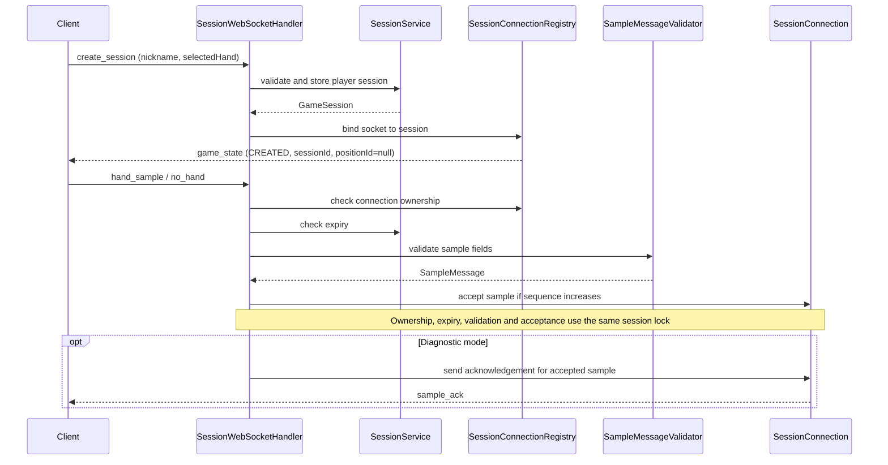
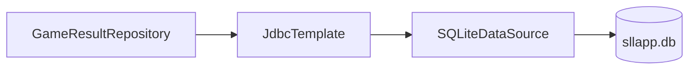

# Backend architecture

The SLLAPP backend uses Java 21 and Spring Boot. It manages player sessions over
WebSocket and validates hand samples. Game results are stored in SQLite and
exposed through a ranking REST API.

See the [README](../README.md) for local setup and commands.

## WebSocket transport

`SessionWebSocketConfiguration` registers the JSON endpoint `/ws`.
`SessionWebSocketProperties` configures application and container message limits.
`WebProperties` supplies the origin list for both REST CORS and the WebSocket
handshake. `SessionWebSocketTest` checks the running server with JDK HTTP and
WebSocket clients.

`model.GameSession` is an immutable player session with UUID, nickname,
selected hand and creation/expiry timestamps. `SessionService` holds sessions
in memory and uses the injected UTC `Clock` (from `ClockConfiguration`) to check
expiry. `NicknamePolicy` validates player names. It uses `BlockedWordList`, which reads the blocked-word
file from `sllapp.moderation.blocked-words-location` once at startup.

`SessionWebSocketHandler` decodes messages and dispatches `create_session` and
`resume_session`. `SessionConnectionRegistry` tracks the active socket for each game
session, replaces it on reconnect and closes it on expiry. Replacement and
sample acceptance use the same session lock. Closing an old socket cannot
detach its replacement. `SessionConnection` serializes outbound sends through
`ConcurrentWebSocketSessionDecorator`.

`SampleMessageValidator` validates `hand_sample` and `no_hand`. A `SampleMessage`
retains the hand JSON, including additional fields. Each `SessionConnection`
stores only the latest accepted sample and sequence number. Validation precedes
sequence advancement; ownership and expiry are checked under the session lock.
Diagnostic acknowledgements are controlled by `SessionWebSocketProperties`.

A task in `SessionConnectionRegistry` runs every second. It asks `SessionService` to
remove expired sessions and closes their current sockets. Incoming messages also
check the deadline. Tests inject a controllable clock to check exact expiry and
ensure that sample traffic and reconnects do not extend the session lifetime.



## Ranking HTTP API

`RankingController` serves `GET /api/ranking` and validates the optional limit
(default 10, range 1–100). Its exception handler maps invalid limits to a
`400 ProblemDetail` response. `RankingService` reads the ordered results from
`GameResultRepository` and assigns positions starting at 1. The controller maps
each `RankingEntry` to a `RankingEntryResponse` with `rank`, `nickname` and `score`.
See the [API reference](api.md).

## Code structure

`web` owns the REST and WebSocket protocols. `service` manages game sessions and
ranks results. Each class in `service` uses `@Service` and has a name ending in
`Service`. `moderation` contains the nickname rules and the blocked-word list.
`model` contains the application data types, and `repository` implements the SQL
queries. WebSocket message records live in `web.websocket.message`, REST DTOs in
`web.rest.dto`.

`config` groups Spring configuration and runtime settings by area.

| Package | Responsibility |
| --- | --- |
| `config.application` | UTC clock and scheduling |
| `config.moderation` | Blocked-word resource location |
| `config.session` | Player session lifetime |
| `config.storage` | SQLite data source and storage directory |
| `config.web` | REST CORS, WebSocket endpoint and message limits |

```text
backend/src/
├── main/
│   ├── java/pl/pjatk/ai/sllapp/
│   │   ├── SllappApplication.java
│   │   ├── config/
│   │   │   ├── application/
│   │   │   │   ├── ClockConfiguration.java
│   │   │   │   └── SchedulingConfiguration.java
│   │   │   ├── moderation/
│   │   │   │   ├── ModerationConfiguration.java
│   │   │   │   └── ModerationProperties.java
│   │   │   ├── session/
│   │   │   │   ├── SessionConfiguration.java
│   │   │   │   └── SessionProperties.java
│   │   │   ├── storage/
│   │   │   │   ├── SqliteConfiguration.java
│   │   │   │   └── StorageProperties.java
│   │   │   └── web/
│   │   │       ├── SessionWebSocketConfiguration.java
│   │   │       ├── SessionWebSocketProperties.java
│   │   │       ├── WebConfiguration.java
│   │   │       └── WebProperties.java
│   │   ├── model/
│   │   │   ├── GameResult.java
│   │   │   ├── GameSession.java
│   │   │   ├── RankingEntry.java
│   │   │   └── SelectedHand.java
│   │   ├── moderation/
│   │   │   ├── BlockedWordList.java
│   │   │   └── NicknamePolicy.java
│   │   ├── repository/
│   │   │   └── GameResultRepository.java
│   │   ├── service/
│   │   │   ├── RankingService.java
│   │   │   └── SessionService.java
│   │   └── web/
│   │       ├── rest/
│   │       │   ├── RankingController.java
│   │       │   └── dto/
│   │       │       └── RankingEntryResponse.java
│   │       └── websocket/
│   │           ├── message/
│   │           │   ├── ErrorMessage.java
│   │           │   ├── GameStateMessage.java
│   │           │   ├── SampleAckMessage.java
│   │           │   └── SampleMessage.java
│   │           ├── SampleMessageValidator.java
│   │           ├── SessionConnection.java
│   │           ├── SessionConnectionRegistry.java
│   │           └── SessionWebSocketHandler.java
│   └── resources/
│       ├── application.yml
│       ├── moderation/
│       │   ├── blocked-words.txt
│       │   ├── LICENSE-LDNOOBW.txt
│       │   └── SOURCES.md
│       └── schema.sql
└── test/
    ├── java/pl/pjatk/ai/sllapp/
    │   ├── moderation/
    │   │   ├── BlockedWordListTest.java
    │   │   └── NicknamePolicyTest.java
    │   ├── repository/
    │   │   └── GameResultRepositoryTest.java
    │   ├── service/
    │   │   └── SessionServiceTest.java
    │   ├── support/
    │   │   └── MutableClock.java
    │   └── web/
    │       ├── rest/
    │       │   └── RankingControllerTest.java
    │       └── websocket/
    │           ├── SampleFixtures.java
    │           ├── SampleMessageValidatorTest.java
    │           ├── SessionExpiryTest.java
    │           ├── SessionOwnershipTest.java
    │           ├── SessionSamplesTest.java
    │           ├── SessionWebSocketTest.java
    │           ├── WebSocketSizeTest.java
    │           └── WebSocketTestClient.java
    └── resources/
        └── moderation/
            └── test-blocked-words.txt
```

| File | Responsibility |
| --- | --- |
| [`SllappApplication.java`](../backend/src/main/java/pl/pjatk/ai/sllapp/SllappApplication.java) | Spring Boot entry point |
| [`GameResult.java`](../backend/src/main/java/pl/pjatk/ai/sllapp/model/GameResult.java) | Immutable result record |
| [`GameResultRepository.java`](../backend/src/main/java/pl/pjatk/ai/sllapp/repository/GameResultRepository.java) | SQL operations through `JdbcTemplate` and row mapping |
| [`SqliteConfiguration.java`](../backend/src/main/java/pl/pjatk/ai/sllapp/config/storage/SqliteConfiguration.java) | Storage directory creation and SQLite `DataSource` |
| [`application.yml`](../backend/src/main/resources/application.yml) | Server, storage and schema initialization settings |
| [`schema.sql`](../backend/src/main/resources/schema.sql) | Result table and ranking index |
| [`blocked-words.txt`](../backend/src/main/resources/moderation/blocked-words.txt) | Default blocked-word list; source and license in [`SOURCES.md`](../backend/src/main/resources/moderation/SOURCES.md) |

## Startup and configuration

`SllappApplication` starts Spring Boot. `SqliteConfiguration` resolves the storage
directory to an absolute path, creates the directory and configures a
`SQLiteDataSource` for `sllapp.db`. Spring runs `schema.sql` on startup through
`spring.sql.init.mode=always`. The schema uses `CREATE TABLE IF NOT EXISTS` and
`CREATE INDEX IF NOT EXISTS`.

| Setting | Value in `application.yml` |
| --- | --- |
| `server.address` | `127.0.0.1` |
| `server.port` | `8080` |
| `sllapp.storage.directory` | `${DATA_DIR:./data}` |
| `spring.sql.init.mode` | `always` |

The default database path is `./data/sllapp.db`, relative to the backend process
working directory. Set `DATA_DIR` to use another directory. Keeping the database
file preserves saved results across application restarts.

The `config` package contains Spring configuration and the types bound through
`@ConfigurationProperties`. `StorageProperties` binds `sllapp.storage.directory`.
Session, moderation and web defaults are declared in `SessionProperties`,
`ModerationProperties`, `SessionWebSocketProperties` and `WebProperties`.
See the [configuration table](api.md#websocket-configuration).
The session registry is local to one application instance and is separate from
SQLite result storage.

## Stored result

`GameResult` is a Java record with `sessionId`, `nickname`, `score` and `finishedAt`.
The repository maps it to `game_results`:

| Column | SQLite type | Constraint |
| --- | --- | --- |
| `session_id` | `TEXT` | Primary key, required |
| `nickname` | `TEXT` | Required |
| `score` | `INTEGER` | Required, non-negative |
| `finished_at` | `TEXT` | Required |

The repository formats the `Instant` finish timestamp in UTC with nine fractional
digits and parses it back to `Instant` on read.

## Repository operations

The repository receives `JdbcTemplate` through its constructor.



`save(GameResult)` inserts a row and returns `true` when the insert succeeds.
`ON CONFLICT (session_id) DO NOTHING` keeps the original row on a repeated session
identifier; the method returns `false` for that duplicate.

`findTopResults(int limit)` returns a list of results in this order:

1. Score descending.
2. Finish time ascending.
3. Session identifier ascending.

The session identifier gives a stable order when score and finish time match.
The `game_results_ranking_idx` index uses the same ordering. The query takes its
row limit as a bound SQL parameter. A limit below 1 causes
`IllegalArgumentException`.

## Test coverage and CI

The WebSocket tests cover creation, nickname validation, resuming, concurrent
ownership changes, delayed close callbacks, expiry with a controlled clock,
sample validation, sequence ordering, optional acknowledgements, CORS/preflight,
UTF-8 size boundaries, fragmented text and oversized binary messages.
`BlockedWordListTest` checks loading of the blocked-word file: comments, BOM,
duplicates, NFKC normalization, the bundled list, and startup errors for missing,
unreadable, malformed, empty or invalid files and directories. Other session
tests use the small list in `test-blocked-words.txt`. Integration
tests use a real embedded server on random ports and temporary SQLite files.

`RankingControllerTest` starts the HTTP server on a random port with a temporary SQLite
database. It checks the empty response, output fields, score and timestamp
ordering, full ties, rank numbering, default and explicit limits, and invalid
parameters with `ProblemDetail` responses.

[`GameResultRepositoryTest`](../backend/src/test/java/pl/pjatk/ai/sllapp/repository/GameResultRepositoryTest.java)
starts application contexts against a temporary SQLite file. It checks:

- Result persistence after closing and restarting the application context.
- Preservation of the original result after a duplicate-session save.
- Score ordering and finish-time tie-breaking, including nanosecond precision.
- Limiting the number of returned results.

Run the backend checks from `backend/`:

```powershell
.\mvnw.cmd -B verify
```

On Linux or macOS, use `sh mvnw -B verify`.
The [CI workflow](../.github/workflows/ci.yml) runs that command with JDK 21 on
Ubuntu for pull requests and pushes to `master`.
