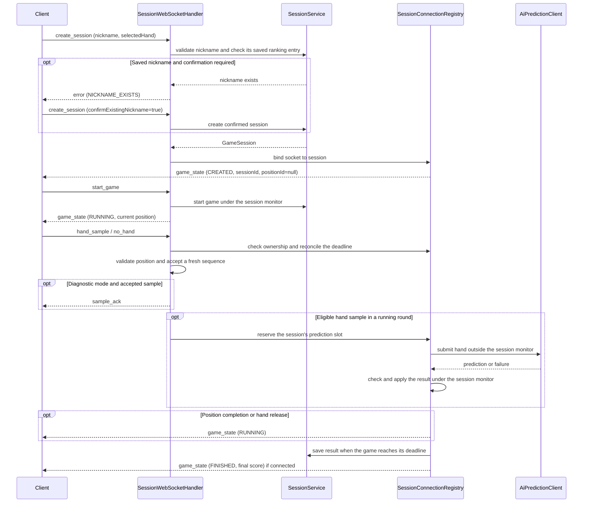
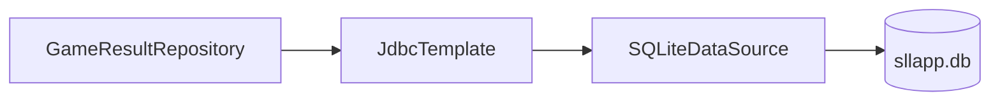

# Backend architecture

The SLLAPP backend uses Java 21 and Spring Boot. It provides a standalone
spelling game engine, manages player sessions over WebSocket and validates
hand samples. Game results are stored in SQLite and exposed through a ranking
REST API.

See [Local development](local-development.md) for commands, ports and test profiles.

## Standalone game engine

The `pl.pjatk.ai.sllapp.game` package uses the JDK. A Java caller creates one
`GameEngine` and one `WordPicker` per game. The caller provides timestamps and
serializes operations on the engine. WebSocket sessions start an engine on
`start_game` and publish its position and score through `game_state`.
See the [API reference](api.md#websocket-transport).

```java
import java.time.Instant;
import pl.pjatk.ai.sllapp.game.GameEngine;
import pl.pjatk.ai.sllapp.game.GameRules;
import pl.pjatk.ai.sllapp.game.RandomWordPicker;
import pl.pjatk.ai.sllapp.game.WordCatalog;

var catalog = WordCatalog.loadBundled();
var now = Instant.now();
var game = new GameEngine(GameRules.defaults(), new RandomWordPicker(catalog), now, now.plusSeconds(60));
var current = game.state(now);
char expectedLetter = current.expectedLetter();

// Call this when the current letter has been recognized.
boolean accepted = game.completePosition(current.positionId(), Instant.now());
```

The catalog can be shared across games. The bundled list is UTF-8, with one
uppercase Polish word per line and several entries for each length from 3 to 7.
See [`game/words.txt`](../backend/src/main/resources/game/words.txt).

Catalog validation strips surrounding whitespace, skips empty lines
and accepts the letters `A B C E I L M N O P R S T U W Y`. It reports invalid
lengths, unsupported characters and duplicate words with line numbers.
`WordCatalog.validate(lines, maxWordLength)` returns the issues.
`WordCatalog.fromLines(lines, maxWordLength)` builds a custom catalog from
valid input. The classpath loader reports resource read failures as
`IOException`.

`RandomWordPicker` checks for at least one word at every playable length
before the engine starts. It draws from a separate pool for each length and
refills a pool once it is empty. Callers can supply a seeded random generator
or a deterministic `WordPicker` that provides valid words for every playable
length. A maximum above 7 needs a custom word source with broader coverage.

Each game starts at position ID 1, at the first letter of a 3-letter word.
Completing the active position advances to the next letter and assigns a new
ID within JavaScript's safe integer range. Completing a word draws a word
one letter longer, up to the configured maximum. The immutable `GameState`
exposes the position ID, word, zero-based letter index, expected letter,
score, remaining milliseconds, finish status and `repeatsPreviousLetter`.
That flag compares the current letter with the last completed letter,
including across word boundaries.

Completions with stale or unknown IDs return `false`. A state read or
completion at or after the deadline finishes the game, preserves the final
position and score, and sets the remaining time to zero. The completion
returns `false`. Remaining time is reported in whole milliseconds, while
expiry uses the instant itself.

The immutable `GameRules` takes a maximum word length of at least 3 and
nonnegative `BigDecimal` scoring values.

| Setting | Standalone default |
| --- | ---: |
| `maxWordLength` | 7 |
| `letterPoints` | 10 |
| `wordBonus` | 20 |
| `multiplierStep` | 1 |

For a word of length `L`, the multiplier is `1 + (L - 3) × multiplierStep`.
Each accepted position adds the scaled letter award. The last position
also adds the scaled word bonus for the same word. The engine rounds
each award separately to the nearest integer with halves rounded up.
The standalone rules award 50 points for a three-letter word and 120 for
a four-letter word. The default configuration for regular rounds uses a
multiplier step of 2, which gives 50 and 180 points respectively.
Score overflow raises an arithmetic error before the engine changes the
position or draws the next word.

### Game engine tester

The `game-test` Spring profile activates `GameTestController` from the test
classpath. It serves the HTML, CSS, JavaScript and JSON endpoints under
`/game-test` at `127.0.0.1:8081`. The controller runs one interactive
game in memory and serializes its operations. Requests include a game ID
so a position from a previous game cannot complete a position after a reset.

The preview starts a 60-second round with `GameRules.defaults()`,
`RandomWordPicker`, the bundled catalog and the backend clock. The
**Complete letter** action passes the displayed position ID to the engine,
simulating a recognized sign. The test profile stores its SQLite database
under `target/game-test-data`. See the
[tester startup instructions](local-development.md#game-engine-tester).

## WebSocket transport

`SessionWebSocketConfiguration` registers the JSON endpoint `/ws`.
`SessionWebSocketProperties` configures application and container message limits.
`WebProperties` supplies the origin list for both REST CORS and the WebSocket
handshake. `SessionWebSocketTest` checks the running server with JDK HTTP and
WebSocket clients.

`model.GameSession` holds player metadata and the game lifecycle. `SessionService`
keeps sessions in memory and validates player names through `NicknamePolicy`.
`BlockedWordList` reads `sllapp.moderation.blocked-words-location` once at startup.
Session creation checks the persisted ranking after validation and requires
confirmation to reuse a nickname with a saved result. Each confirmed replay
creates its own session. [Session creation contract](api.md#create-a-session)
On start, the session creates a `GameEngine` with the configured `GameRules`
and its own picker. The production picker factory shares the bundled
`WordCatalog`.

`SessionWebSocketHandler` dispatches `create_session`, `resume_session`,
`start_game`, `hand_sample` and `no_hand`. `SessionConnectionRegistry` tracks
the current socket for each session. The same session monitor serializes socket
replacement, game operations and removal. Closing an old socket cannot detach
its replacement. `SessionConnection` serializes outbound sends through
`ConcurrentWebSocketSessionDecorator`.

`SampleMessageValidator` checks each sample against the session's current
position before the connection advances its sequence. A `SampleMessage` retains
the position ID and hand JSON, including additional fields. Diagnostic
acknowledgements are controlled by `SessionWebSocketProperties`.

`GameSession` holds `LetterRecognition`, which tracks the prediction count,
the first and latest qualifying sample times, hand release and the single
in-flight request. The registry reserves that slot
under the session monitor and submits to `AiPredictionClient` outside the
monitor. The completion callback acquires the monitor to release the slot and
verify the running game, owning socket, active position and elapsed budget
before updating the series. Sample timing and the call budget use monotonic
time. A series qualifies once its count and hold time reach their configured
thresholds. `SessionConnectionRegistry.completePosition` is the common path for
advancing the engine and publishing a confirmed completion. A hand release
publishes a new state at the same position. See the
[recognition rules and settings](api.md#letter-recognition).

`ClockConfiguration` supplies the UTC `Clock` used for the creation expiry, game
deadline and finished expiry. The registry checks the deadline under the session
monitor on incoming messages, resume and position completion, and in a sweep
every second. On finish, it freezes the score, attempts one SQLite insert and
publishes `FINISHED` to the current socket. The result timestamp is the game
deadline. The sweep retries pending writes, including for disconnected games
and after public expiry. After expiry it closes any bound socket with code 1008
and removes sessions once their results are stored.



## Ranking HTTP API

`RankingController` serves `GET /api/ranking` and validates the optional limit
(default 10, range 1–100). Its exception handler maps invalid limits to a
`400 ProblemDetail` response. `RankingService` reads the ordered results from
`GameResultRepository` and assigns positions starting at 1. The controller maps
each `RankingEntry` to a `RankingEntryResponse` with `rank`, `nickname` and `score`.
See the [API reference](api.md).

## AI prediction client

`AiPredictionClient.predict(sessionId, hand)` accepts a session UUID and the
validated JSON `hand` object. It returns a `CompletionStage<PredictionResult>`
with a typed letter and confidence or a typed failure. A dedicated executor
runs up to four exchanges at once and rejects further submissions immediately
with `OVERLOADED`. One Spring `RestClient` and one JDK `HttpClient` reuse
connections. The call timeout covers connecting, receiving headers and reading
the response body. Prediction requests have no application-level retries.

The client sends the `hand` object unchanged to `POST /predict` as UTF-8 JSON with
an explicit byte-count `Content-Length`. The Python service requires
`coordinateSpace: "MEDIAPIPE_IMAGE"`, physical `handedness` and 21 image landmarks.
The game and the recognition diagnostics panel supply the coordinate space on
their camera samples.
The result is a prediction only for HTTP 200 with a supported uppercase letter
and numeric confidence from 0 to 1, inclusive. During a game the session
applies the [recognition rules](api.md#letter-recognition) to the result.

| Failure | Cause |
| --- | --- |
| `DISABLED` | The client is disabled |
| `INVALID_REQUEST` | Invalid local input or HTTP 400 |
| `PAYLOAD_TOO_LARGE` | HTTP 413 |
| `REJECTED_SAMPLE` | HTTP 422 |
| `SERVICE_ERROR` | HTTP 5xx |
| `UNEXPECTED_STATUS` | Other HTTP status |
| `CONTRACT_ERROR` | HTTP 200 with an invalid prediction body |
| `TIMEOUT` | The call exceeded its transport deadline |
| `TRANSPORT_ERROR` | A connection or other transport failure |
| `OVERLOADED` | All prediction workers are occupied |

Each failed prediction increments an in-process counter for its category and
logs the session UUID, category, HTTP status when known and cumulative count.
`failureCount(kind)` reads that counter. A failure can carry the service's
optional `error` text for the caller. Logs contain neither hand data nor error
response bodies. `DISABLED` is a configuration state and does not count as a
failed prediction.

| Spring property | Environment variable | Default |
| --- | --- | --- |
| `sllapp.ai.enabled` | `AI_PREDICTION_ENABLED` | `false` |
| `sllapp.ai.base-url` | `AI_PREDICTION_BASE_URL` | Required when enabled |
| `sllapp.ai.timeout` | `AI_PREDICTION_TIMEOUT` | `250ms` |

An enabled client requires an absolute HTTP(S) URL and a positive timeout.
When enabled, it calls `GET /health` once after backend startup and logs the
model variant, classifier, 16 letters and artifact SHA-256. A failed health
check logs a warning and the application continues to run. See the
[Python service contract](../model/README.md#prediction-service) and
[local AI startup](local-development.md#run-recognition-with-the-python-service).

### Camera recognition diagnostics

The regular game WebSocket can publish a
[`prediction_result`](api.md#round-prediction-diagnostics) to a connection
that opts in while backend diagnostics are enabled. It reports the outcome of
the round's existing prediction attempt after the recognition rules run. A
separate sender with zero queue capacity drops reports while busy, keeping
diagnostic sends outside the game monitor.

The local `recognition-test` profile uses the test classpath and binds to
`127.0.0.1:8082` by default. The `recognition-ai` Maven shortcut activates
the same panel with prediction enabled and a default service URL of
`http://127.0.0.1:8000`. Its page uses the same frontend hand tracker
and normalization as the camera preview. It sends `hand_sample` and
`no_hand` with `positionId: null` to a dedicated WebSocket at
`/recognition-test/ws`. The endpoint uses the existing sample validator.
It acknowledges accepted samples and reports skips for absent hands, repeated
sequences and occupied prediction capacity.

The diagnostic instance of `AiPredictionClient` records the HTTP request body
and the bytes read by the client, with up to 8192 bytes of response displayed.
Each result carries the sample sequence, elapsed time and either the decoded
prediction or the failure. One prediction runs at a time across the diagnostic
connections to keep each trace associated with its sample. The diagnostic
endpoint has no game lifecycle. See the [local startup instructions](local-development.md#recognition-diagnostics).

## Code structure

Production classes live under `backend/src/main/java/pl/pjatk/ai/sllapp/`.
The local test panels use the test classpath.

| Package | Responsibility |
| --- | --- |
| `game` | Game state, scoring, word catalog and picker |
| `model` | Sessions, results and ranking entries |
| `service` | Session lifecycle and ranking queries |
| `web.websocket` | Session protocol, validation and socket ownership |
| `web.rest` | Ranking endpoint and REST response types |
| `ai` | Asynchronous client and typed prediction results |
| `moderation` | Nickname policy and blocked words |
| `repository` | SQLite queries through Spring JDBC |
| `config` | Spring bindings for AI, clock, scheduling, moderation, sessions, storage and web |

## Startup and configuration

`SllappApplication` starts Spring Boot. `SqliteConfiguration` resolves the storage
directory to an absolute path, creates the directory and configures a
`SQLiteDataSource` for `sllapp.db`. `SqliteSchema` initializes the database
before that data source becomes available to the rest of the application.
It reads `PRAGMA user_version` inside an immediate transaction. For an empty
database it applies `schema.sql`. For an existing database at version 0 it
rebuilds `game_results`, retaining the highest score per nickname. It resolves
ties by earliest finish time and then by lowest session identifier. It records
version 1 in the same transaction. A migration failure rolls back the schema
and data changes.

| Setting | Value in `application.yml` |
| --- | --- |
| `server.address` | `127.0.0.1` |
| `server.port` | `8080` |
| `sllapp.storage.directory` | `${DATA_DIR:./data}` |

The default database path is `./data/sllapp.db`, relative to the backend process
working directory. Set `DATA_DIR` to use another directory. Keeping the database
file preserves saved results across application restarts.

The `config` package contains Spring configuration and the types bound through
`@ConfigurationProperties`. `StorageProperties` binds `sllapp.storage.directory`.
The defaults for `SessionProperties`, `ScoringProperties` and
`RecognitionProperties` are in `backend/src/main/resources/application.yml`.
`SessionConfiguration` builds `GameRules` from the scoring settings, and
`SessionService` passes those rules to the engine when a regular round starts.
Creation expiry defaults to `5m`, game duration to `60s` and the finished
resume window to `5m`. All three durations must be positive.
See the [configuration table](api.md#websocket-configuration).
The session registry is local to one application instance and is separate from
SQLite result storage.

## Stored result

`GameResult` is a Java record with `sessionId`, `nickname`, `score` and `finishedAt`.
The repository maps it to `game_results`:

| Column | SQLite type | Constraint |
| --- | --- | --- |
| `session_id` | `TEXT` | Primary key, required |
| `nickname` | `TEXT` | Display nickname, required |
| `nickname_key` | `TEXT` | Normalized nickname, required and unique |
| `score` | `INTEGER` | Required, non-negative |
| `finished_at` | `TEXT` | Required |

The repository formats the `Instant` finish timestamp in UTC with nine fractional
digits and parses it back to `Instant` on read.

## Repository operations

The repository receives `JdbcTemplate` through its constructor.



`findNickname` reads the display nickname by the normalized nickname key.
`save(GameResult)` uses one SQLite statement to insert a new entry or update
the existing one when the new score is higher. A repeated session identifier,
a lower score or an equal score returns `false`. An insert or an improvement
returns `true`. The display nickname stays with the entry across improvements.
The session service treats either return value as a completed write and retries
storage errors in the session sweep.

`findTopResults(int limit)` returns a list of results in this order:

1. Score descending.
2. Finish time ascending.
3. Session identifier ascending.

The session identifier gives a stable order when score and finish time match.
The `game_results_ranking_idx` index uses the same ordering. The query takes its
row limit as a bound SQL parameter. A limit below 1 causes
`IllegalArgumentException`.

## Test coverage and CI

| Area | Coverage |
| --- | --- |
| Game engine | Catalog validation, pool refill, scoring, position changes, expiry and repeated letters |
| Session and WebSocket | Creation, start and resume, connection replacement, input validation, deadlines and result persistence |
| Letter recognition | Streaks, hand release, late results, prediction limits and replay of a recorded camera timeline |
| Prediction client | HTTP contract, connection reuse, timeouts, executor saturation and graceful startup when the service is unavailable |
| Test panels | Profile isolation, simulated game completion and diagnostics with successful, failed, malformed and unavailable AI responses |
| Ranking and storage | Ordering and limits, errors, schema migration and rollback, nickname normalization, concurrent writes, retries and nanosecond precision |

The engine tests control time and word selection. The integration tests start
embedded servers on random ports and use temporary SQLite files.
[Run the automated checks](local-development.md#automated-checks)
