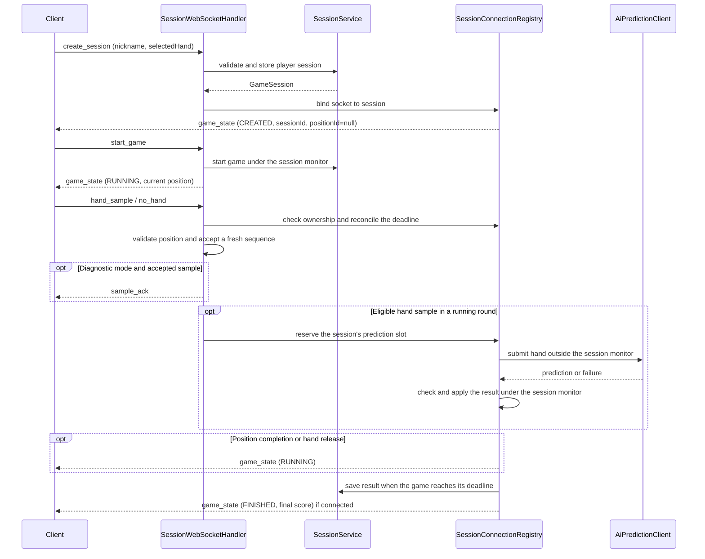
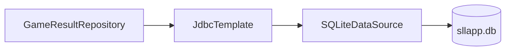

# Backend architecture

The SLLAPP backend uses Java 21 and Spring Boot. It provides a standalone
spelling game engine, manages player sessions over WebSocket and validates
hand samples. Game results are stored in SQLite and exposed through a ranking
REST API.

See the [README](../README.md) for local setup and commands.

## Standalone game engine

The `pl.pjatk.ai.sllapp.game` package uses the JDK. A Java caller creates one
`GameEngine` and one `WordPicker` per game. The caller provides timestamps and
serializes operations on the engine. WebSocket sessions start an engine on
`start_game` and publish its position and score through `game_state`.
See the [API reference](api.md#websocket-transport).

```java
import java.time.Instant;
import pl.pjatk.ai.sllapp.game.GameEngine;
import pl.pjatk.ai.sllapp.game.GameRules;
import pl.pjatk.ai.sllapp.game.RandomWordPicker;
import pl.pjatk.ai.sllapp.game.WordCatalog;

var catalog = WordCatalog.loadBundled();
var now = Instant.now();
var game = new GameEngine(GameRules.defaults(), new RandomWordPicker(catalog), now, now.plusSeconds(60));
var current = game.state(now);
char expectedLetter = current.expectedLetter();

// Call this when the current letter has been recognized.
boolean accepted = game.completePosition(current.positionId(), Instant.now());
```

The catalog can be shared across games. The bundled list is UTF-8, with one
uppercase Polish word per line and several entries for each length from 3 to 7.
See [`game/words.txt`](../backend/src/main/resources/game/words.txt).

Catalog validation strips surrounding whitespace, skips empty lines
and accepts the letters `A B C E I L M N O P R S T U W Y`. It reports invalid
lengths, unsupported characters and duplicate words with line numbers.
`WordCatalog.validate(lines, maxWordLength)` returns the issues.
`WordCatalog.fromLines(lines, maxWordLength)` builds a custom catalog from
valid input. The classpath loader reports resource read failures as
`IOException`.

`RandomWordPicker` checks for at least one word at every playable length
before the engine starts. It draws from a separate pool for each length and
refills a pool once it is empty. Callers can supply a seeded random generator
or a deterministic `WordPicker` that provides valid words for every playable
length. A maximum above 7 needs a custom word source with broader coverage.

Each game starts at position ID 1, at the first letter of a 3-letter word.
Completing the active position advances to the next letter and assigns a new
ID within JavaScript's safe integer range. Completing a word draws a word
one letter longer, up to the configured maximum. The immutable `GameState`
exposes the position ID, word, zero-based letter index, expected letter,
score, remaining milliseconds, finish status and `repeatsPreviousLetter`.
That flag compares the current letter with the last completed letter,
including across word boundaries.

Completions with stale or unknown IDs return `false`. A state read or
completion at or after the deadline finishes the game, preserves the final
position and score, and sets the remaining time to zero. The completion
returns `false`. Remaining time is reported in whole milliseconds, while
expiry uses the instant itself.

The immutable `GameRules` takes a maximum word length of at least 3 and
nonnegative `BigDecimal` scoring values.

| Setting | Default |
| --- | ---: |
| `maxWordLength` | 7 |
| `letterPoints` | 10 |
| `wordBonus` | 20 |
| `multiplierStep` | 1 |

For a word of length `L`, the multiplier is `1 + (L - 3) × multiplierStep`.
Each accepted position adds the scaled letter award. The last position
also adds the scaled word bonus for the same word. The engine rounds
each award separately to the nearest integer with halves rounded up.
With the default rules, completing a 4-letter word adds 120 points.
Score overflow raises an arithmetic error before the engine changes the
position or draws the next word.

### Game engine tester

The `game-test` Spring profile activates `GameTestController` from the test
classpath. It serves the HTML, CSS, JavaScript and JSON endpoints under
`/game-test` at `127.0.0.1:8081`. The controller runs one interactive
game in memory and serializes its operations. Requests include a game ID
so a position from a previous game cannot complete a position after a reset.

The preview starts a 60-second round with `GameRules.defaults()`,
`RandomWordPicker`, the bundled catalog and the backend clock. The
**Complete letter** action passes the displayed position ID to the engine,
simulating a recognized sign. The test profile stores its SQLite database
under `target/game-test-data`. See the
[README startup instructions](../README.md#open-the-game-engine-tester).

## WebSocket transport

`SessionWebSocketConfiguration` registers the JSON endpoint `/ws`.
`SessionWebSocketProperties` configures application and container message limits.
`WebProperties` supplies the origin list for both REST CORS and the WebSocket
handshake. `SessionWebSocketTest` checks the running server with JDK HTTP and
WebSocket clients.

`model.GameSession` holds player metadata and the game lifecycle. `SessionService`
keeps sessions in memory and validates player names through `NicknamePolicy`.
`BlockedWordList` reads `sllapp.moderation.blocked-words-location` once at startup.
On start, the session creates a `GameEngine` with `GameRules.defaults()` and its
own picker. The production picker factory shares the bundled `WordCatalog`.

`SessionWebSocketHandler` dispatches `create_session`, `resume_session`,
`start_game`, `hand_sample` and `no_hand`. `SessionConnectionRegistry` tracks
the current socket for each session. The same session monitor serializes socket
replacement, game operations and removal. Closing an old socket cannot detach
its replacement. `SessionConnection` serializes outbound sends through
`ConcurrentWebSocketSessionDecorator`.

`SampleMessageValidator` checks each sample against the session's current
position before the connection advances its sequence. A `SampleMessage` retains
the position ID and hand JSON, including additional fields. Diagnostic
acknowledgements are controlled by `SessionWebSocketProperties`.

`GameSession` holds `LetterRecognition`, which tracks the prediction streak,
hand release and the single in-flight request. The registry reserves that slot
under the session monitor and submits to `AiPredictionClient` outside the
monitor. The completion callback acquires the monitor to release the slot and
verify the running game, owning socket, active position and elapsed budget
before updating the streak. Sample timing and the call budget use monotonic
time. `SessionConnectionRegistry.completePosition` is the common path for
advancing the engine and publishing a confirmed completion. A hand release
publishes a new state at the same position. See the
[recognition rules and settings](api.md#letter-recognition).

`ClockConfiguration` supplies the UTC `Clock` used for the creation expiry, game
deadline and finished expiry. The registry checks the deadline under the session
monitor on incoming messages, resume and position completion, and in a sweep
every second. On finish, it freezes the score, attempts one SQLite insert and
publishes `FINISHED` to the current socket. The result timestamp is the game
deadline. The sweep retries pending writes, including for disconnected games
and after public expiry. After expiry it closes any bound socket with code 1008
and removes sessions once their results are stored.



## Ranking HTTP API

`RankingController` serves `GET /api/ranking` and validates the optional limit
(default 10, range 1–100). Its exception handler maps invalid limits to a
`400 ProblemDetail` response. `RankingService` reads the ordered results from
`GameResultRepository` and assigns positions starting at 1. The controller maps
each `RankingEntry` to a `RankingEntryResponse` with `rank`, `nickname` and `score`.
See the [API reference](api.md).

## AI prediction client

`AiPredictionClient.predict(sessionId, hand)` accepts a session UUID and the
validated JSON `hand` object. It returns a `CompletionStage<PredictionResult>`
with a typed letter and confidence or a typed failure. A dedicated executor
runs up to four exchanges at once and rejects further submissions immediately
with `OVERLOADED`. One Spring `RestClient` and one JDK `HttpClient` reuse
connections. The call timeout covers connecting, receiving headers and reading
the response body. Prediction requests have no application-level retries.

The client sends the `hand` object unchanged to `POST /predict` as UTF-8 JSON with
an explicit byte-count `Content-Length`. The Python service requires
`coordinateSpace: "MEDIAPIPE_IMAGE"`, physical `handedness` and 21 image landmarks.
The caller supplies the coordinate space, which the current camera stream omits.
The result is a prediction only for HTTP 200 with a supported uppercase letter
and numeric confidence from 0 to 1, inclusive. The session applies the
[recognition rules](api.md#letter-recognition) to the result.

| Failure | Cause |
| --- | --- |
| `DISABLED` | The client is disabled |
| `INVALID_REQUEST` | Invalid local input or HTTP 400 |
| `PAYLOAD_TOO_LARGE` | HTTP 413 |
| `REJECTED_SAMPLE` | HTTP 422 |
| `SERVICE_ERROR` | HTTP 5xx |
| `UNEXPECTED_STATUS` | Other HTTP status |
| `CONTRACT_ERROR` | HTTP 200 with an invalid prediction body |
| `TIMEOUT` | The call exceeded its transport deadline |
| `TRANSPORT_ERROR` | A connection or other transport failure |
| `OVERLOADED` | All prediction workers are occupied |

Each failed prediction increments an in-process counter for its category and
logs the session UUID, category, HTTP status when known and cumulative count.
`failureCount(kind)` reads that counter. A failure can carry the service's
optional `error` text for the caller. Logs contain neither hand data nor error
response bodies. `DISABLED` is a configuration state and does not count as a
failed prediction.

| Spring property | Environment variable | Default |
| --- | --- | --- |
| `sllapp.ai.enabled` | `AI_PREDICTION_ENABLED` | `false` |
| `sllapp.ai.base-url` | `AI_PREDICTION_BASE_URL` | Required when enabled |
| `sllapp.ai.timeout` | `AI_PREDICTION_TIMEOUT` | `250ms` |

An enabled client requires an absolute HTTP(S) URL and a positive timeout.
When enabled, it calls `GET /health` once after backend startup and logs the
model variant, classifier, 16 letters and artifact SHA-256. A failed health
check logs a warning and the application continues to run. See the
[Python service contract](../model/README.md#prediction-service) and
[backend startup example](../README.md#connect-the-prediction-service).

## Code structure

`game` owns the standalone game rules and state. `web` owns the REST and
WebSocket protocols. `service` manages game sessions and ranks results. Each
class in `service` uses `@Service` and has a name ending in
`Service`. `moderation` contains the nickname rules and the blocked-word list.
`model` contains the application data types, and `repository` implements the SQL
queries. WebSocket message records live in `web.websocket.message`, REST DTOs in
`web.rest.dto`.

`config` groups Spring configuration and runtime settings by area.

| Package | Responsibility |
| --- | --- |
| `config.ai` | Prediction client settings and Spring bean |
| `config.application` | UTC clock and scheduling |
| `config.moderation` | Blocked-word resource location |
| `config.session` | Player session lifetime and letter recognition settings |
| `config.storage` | SQLite data source and storage directory |
| `config.web` | REST CORS, WebSocket endpoint and message limits |

```text
backend/src/
├── main/
│   ├── java/pl/pjatk/ai/sllapp/
│   │   ├── SllappApplication.java
│   │   ├── ai/
│   │   │   ├── AiPredictionClient.java
│   │   │   └── PredictionResult.java
│   │   ├── config/
│   │   │   ├── ai/
│   │   │   │   ├── AiConfiguration.java
│   │   │   │   └── AiProperties.java
│   │   │   ├── application/
│   │   │   │   ├── ClockConfiguration.java
│   │   │   │   └── SchedulingConfiguration.java
│   │   │   ├── moderation/
│   │   │   │   ├── ModerationConfiguration.java
│   │   │   │   └── ModerationProperties.java
│   │   │   ├── session/
│   │   │   │   ├── RecognitionProperties.java
│   │   │   │   ├── SessionConfiguration.java
│   │   │   │   └── SessionProperties.java
│   │   │   ├── storage/
│   │   │   │   ├── SqliteConfiguration.java
│   │   │   │   └── StorageProperties.java
│   │   │   └── web/
│   │   │       ├── SessionWebSocketConfiguration.java
│   │   │       ├── SessionWebSocketProperties.java
│   │   │       ├── WebConfiguration.java
│   │   │       └── WebProperties.java
│   │   ├── game/
│   │   │   ├── GameEngine.java
│   │   │   ├── GameRules.java
│   │   │   ├── GameState.java
│   │   │   ├── RandomWordPicker.java
│   │   │   ├── WordCatalog.java
│   │   │   └── WordPicker.java
│   │   ├── model/
│   │   │   ├── GameResult.java
│   │   │   ├── GameSession.java
│   │   │   ├── LetterRecognition.java
│   │   │   ├── RankingEntry.java
│   │   │   └── SelectedHand.java
│   │   ├── moderation/
│   │   │   ├── BlockedWordList.java
│   │   │   └── NicknamePolicy.java
│   │   ├── repository/
│   │   │   └── GameResultRepository.java
│   │   ├── service/
│   │   │   ├── RankingService.java
│   │   │   └── SessionService.java
│   │   └── web/
│   │       ├── rest/
│   │       │   ├── RankingController.java
│   │       │   └── dto/
│   │       │       └── RankingEntryResponse.java
│   │       └── websocket/
│   │           ├── message/
│   │           │   ├── ErrorMessage.java
│   │           │   ├── GameStateMessage.java
│   │           │   ├── SampleAckMessage.java
│   │           │   └── SampleMessage.java
│   │           ├── SampleMessageValidator.java
│   │           ├── SessionConnection.java
│   │           ├── SessionConnectionRegistry.java
│   │           └── SessionWebSocketHandler.java
│   └── resources/
│       ├── application.yml
│       ├── game/
│       │   └── words.txt
│       ├── moderation/
│       │   ├── blocked-words.txt
│       │   ├── LICENSE-LDNOOBW.txt
│       │   └── SOURCES.md
│       └── schema.sql
└── test/
    ├── java/pl/pjatk/ai/sllapp/
    │   ├── game/
    │   │   ├── GameEngineTest.java
    │   │   ├── GameRulesTest.java
    │   │   ├── RandomWordPickerTest.java
    │   │   └── WordCatalogTest.java
    │   ├── moderation/
    │   │   ├── BlockedWordListTest.java
    │   │   └── NicknamePolicyTest.java
    │   ├── repository/
    │   │   └── GameResultRepositoryTest.java
    │   ├── service/
    │   │   └── SessionServiceTest.java
    │   ├── support/
    │   │   └── MutableClock.java
    │   └── web/
    │       ├── rest/
    │       │   └── RankingControllerTest.java
    │       └── websocket/
    │           ├── SampleFixtures.java
    │           ├── SampleMessageValidatorTest.java
    │           ├── SessionExpiryTest.java
    │           ├── SessionGameTest.java
    │           ├── SessionOwnershipTest.java
    │           ├── SessionRecognitionTest.java
    │           ├── SessionSamplesTest.java
    │           ├── SessionWebSocketTest.java
    │           ├── WebSocketSizeTest.java
    │           └── WebSocketTestClient.java
    └── resources/
        ├── moderation/
        │   └── test-blocked-words.txt
        └── recognition/
            └── camera-trace.csv
```

| File | Responsibility |
| --- | --- |
| [`SllappApplication.java`](../backend/src/main/java/pl/pjatk/ai/sllapp/SllappApplication.java) | Spring Boot entry point |
| [`GameResult.java`](../backend/src/main/java/pl/pjatk/ai/sllapp/model/GameResult.java) | Immutable result record |
| [`GameResultRepository.java`](../backend/src/main/java/pl/pjatk/ai/sllapp/repository/GameResultRepository.java) | SQL operations through `JdbcTemplate` and row mapping |
| [`SqliteConfiguration.java`](../backend/src/main/java/pl/pjatk/ai/sllapp/config/storage/SqliteConfiguration.java) | Storage directory creation and SQLite `DataSource` |
| [`application.yml`](../backend/src/main/resources/application.yml) | Server, storage and schema initialization settings |
| [`schema.sql`](../backend/src/main/resources/schema.sql) | Result table and ranking index |
| [`blocked-words.txt`](../backend/src/main/resources/moderation/blocked-words.txt) | Default blocked-word list; source and license in [`SOURCES.md`](../backend/src/main/resources/moderation/SOURCES.md) |

## Startup and configuration

`SllappApplication` starts Spring Boot. `SqliteConfiguration` resolves the storage
directory to an absolute path, creates the directory and configures a
`SQLiteDataSource` for `sllapp.db`. Spring runs `schema.sql` on startup through
`spring.sql.init.mode=always`. The schema uses `CREATE TABLE IF NOT EXISTS` and
`CREATE INDEX IF NOT EXISTS`.

| Setting | Value in `application.yml` |
| --- | --- |
| `server.address` | `127.0.0.1` |
| `server.port` | `8080` |
| `sllapp.storage.directory` | `${DATA_DIR:./data}` |
| `spring.sql.init.mode` | `always` |

The default database path is `./data/sllapp.db`, relative to the backend process
working directory. Set `DATA_DIR` to use another directory. Keeping the database
file preserves saved results across application restarts.

The `config` package contains Spring configuration and the types bound through
`@ConfigurationProperties`. `StorageProperties` binds `sllapp.storage.directory`.
Session, recognition, moderation and web defaults are declared in
`SessionProperties`, `RecognitionProperties`, `ModerationProperties`,
`SessionWebSocketProperties` and `WebProperties`.
Creation expiry defaults to `5m`, game duration to `60s` and the finished resume
window to `5m`. All three durations must be positive.
See the [configuration table](api.md#websocket-configuration).
The session registry is local to one application instance and is separate from
SQLite result storage.

## Stored result

`GameResult` is a Java record with `sessionId`, `nickname`, `score` and `finishedAt`.
The repository maps it to `game_results`:

| Column | SQLite type | Constraint |
| --- | --- | --- |
| `session_id` | `TEXT` | Primary key, required |
| `nickname` | `TEXT` | Required |
| `score` | `INTEGER` | Required, non-negative |
| `finished_at` | `TEXT` | Required |

The repository formats the `Instant` finish timestamp in UTC with nine fractional
digits and parses it back to `Instant` on read.

## Repository operations

The repository receives `JdbcTemplate` through its constructor.



`save(GameResult)` inserts a row and returns `true` when the insert succeeds.
`ON CONFLICT (session_id) DO NOTHING` keeps the original row on a repeated session
identifier; the method returns `false` for that duplicate.

`findTopResults(int limit)` returns a list of results in this order:

1. Score descending.
2. Finish time ascending.
3. Session identifier ascending.

The session identifier gives a stable order when score and finish time match.
The `game_results_ranking_idx` index uses the same ordering. The query takes its
row limit as a bound SQL parameter. A limit below 1 causes
`IllegalArgumentException`.

## Test coverage and CI

The game tests use fixed instants and controlled word picks without a Spring
context. They check the bundled catalog, word pool refill, scoring, position
progression, expiry and repeated letters. Run them from `backend/` with
`sh mvnw -B '-Dtest=pl.pjatk.ai.sllapp.game.*Test' test`.

The prediction tests use `MockRestServiceServer` for request and response
validation. A local HTTP server checks the wire byte count, connection reuse,
asynchronous execution, executor saturation and timeouts in both the header
and body phases. Startup tests verify settings, metadata and graceful operation
when health checks fail.

The WebSocket tests cover creation, nickname validation, resuming, concurrent
ownership changes, delayed close callbacks, expiry with a controlled clock,
sample validation, sequence ordering, optional acknowledgements, CORS/preflight,
UTF-8 size boundaries, fragmented text and oversized binary messages.
`SessionGameTest` uses a deterministic picker and a controlled clock to check
start, completion, state-specific samples, scheduled finish, resume, ranking
and persistence retries after expiry. `SessionOwnershipTest` checks concurrent
start and persistence after a socket send failure.
`SessionRecognitionTest` controls sample time and AI responses to check scoring,
streak resets, release, expired results and the single-call rule. It also
replays an event timeline derived from a camera recording.
`BlockedWordListTest` checks loading of the blocked-word file: comments, BOM,
duplicates, NFKC normalization, the bundled list, and startup errors for missing,
unreadable, malformed, empty or invalid files and directories. Other session
tests use the small list in `test-blocked-words.txt`. Integration
tests use a real embedded server on random ports and temporary SQLite files.

`RankingControllerTest` starts the HTTP server on a random port with a temporary SQLite
database. It checks the empty response, output fields, score and timestamp
ordering, full ties, rank numbering, default and explicit limits, and invalid
parameters with `ProblemDetail` responses.

[`GameResultRepositoryTest`](../backend/src/test/java/pl/pjatk/ai/sllapp/repository/GameResultRepositoryTest.java)
starts application contexts against a temporary SQLite file. It checks:

- Result persistence after closing and restarting the application context.
- Preservation of the original result after a duplicate-session save.
- Score ordering and finish-time tie-breaking, including nanosecond precision.
- Limiting the number of returned results.

Run the backend checks from `backend/`:

```powershell
.\mvnw.cmd -B verify
```

On Linux or macOS, use `sh mvnw -B verify`.
The [CI workflow](../.github/workflows/ci.yml) runs that command with JDK 21 on
Ubuntu for pull requests and pushes to `master`.
